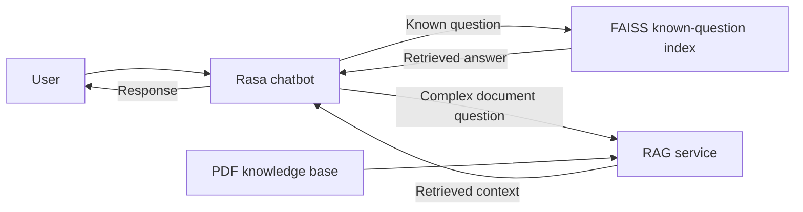

# 🧠 AI Chatbot Platform

A smart, multilingual chatbot developed by **[ESSID Saria]** with **Rasa** and Python, designed for internal use at **[DSI]**.

> ⚠️ **NOTICE**  
> This project is intended **strictly for internal use** within DSI. Unauthorized reproduction, distribution, or reuse—particularly for external, personal, academic, or commercial use—is **prohibited**.

---

## 🛠️ Technologies Used

- **Conversational orchestration:** Rasa
- **Custom actions and routing:** Python
- **Known-question retrieval:** FAISS
- **Complex, document-based questions:** RAG retrieval over PDF documents
- **Deployment:** Docker (where configured)

---

## 🔎 Hybrid Question Answering

The chatbot uses two retrieval paths, selected according to the question:

- **Known questions:** retrieve a matching answer from the FAISS index.
- **Complex questions:** use the RAG service to retrieve relevant context from PDF documents; Rasa then uses that context to prepare the response.

---

## Hybrid Intent Routing

The chatbot routes approximately 83 intents to different response paths:

| Route                   | Intents | Response source                                                                                                 |
|-------------------------|--------:|-----------------------------------------------------------------------------------------------------------------|
| Default                 |       5 | Default conversation handling, including `nlu_fallback`, `affirm_helpful`, `deny_helpful`, `affirm`, and `deny` |
| Easy: candidate results |       6 | Spring Boot services                                                                                            |
| Easy: FAQ               |      22 | Direct semantic search using FAISS                                                                              |
| Exceptions              |      10 | Local PDF or JSON files                                                                                         |
| Hard questions          |      40 | RAG retrieval over Markdown knowledge-base files                                                                |

When a question does not match the FAQ similarity threshold, the conversation is passed to `ActionMaintainConversationFlow` for LLM-based fallback handling.

### Out-of-scope and missing-context behavior

The fallback prompt includes instructions from `solo_feedback()`.
When a question is unrelated to PGPG, ESPRIT, or DSI—or when the RAG context is empty—the LLM is instructed to explain the chatbot’s scope.
It may provide general information when appropriate, clearly marked as general rather than official PGPG information.
If the user expresses an emotion, the chatbot responds empathetically before explaining its scope.

### Examples

#### Example-1
**User:** Je vais acheter un PC. Quel est le modèle le plus performant ?

**Bot:** Comme votre question porte sur l'achat d'un PC, il s'agit d'un sujet hors contexte du système PGPG ; à titre informatif uniquement (basé sur des connaissances générales et non sur les informations officielles PGPG), les modèles les plus performants actuellement sur le marché sont généralement des stations de travail comme le Dell Precision ou des ordinateurs portables haut de gamme gaming/création comme le ASUS ROG Zephyrus ou le MacBook Pro M3 Max, mais je me limite exclusivement à l'assistance PGPG pour vos passages de grade.

#### Example-2
**User:** donner la mission de ef

**Bot:** En tant que candidat Enseignant Formateur (EF), vos missions consistent à assurer des modules d’enseignement en autonomie, à encadrer des projets étudiants et des stages, à participer à la conception et à l’évaluation des examens, ainsi qu’à contribuer à l’amélioration des contenus pédagogiques, tout en sachant que vous ne gérez pas les sessions.

---

## 📌 Project Purpose

This chatbot was developed to:
- Assist employees with real-time, AI-driven support on internal platforms
- Handle multilingual queries (English, Arabic, etc.): To be done in near future
- Automate common FAQ and support tasks
- Serve as an evolving knowledge assistant for the enterprise

---

## 🔒 Intellectual Property & Usage Policy

This repository is the intellectual property of **[ESSID Saria]**, developed during tenure at **[DSI]**, with clear contributions tracked via Git.

All contributors are allowed to:
- Use this platform for internal purposes only
- Contribute to its improvement under company authorization

You **must not**:
- Reuse the codebase for personal academic projects
- Fork or clone this repository for external use
- Publish this code or its parts on public platforms (e.g., GitHub, GitLab, StackOverflow)
- Share with or sell to third parties

Violations will be reported and may lead to **disciplinary or legal action** depending on the terms of your employment or internship agreement.

---

## 🧾 Author & Ownership

- **Main Developer:** [ESSID Saria] ([saria.essid@esprit.tn])
- **Status:** Sole author and maintainer during initial development (100% commit history)
- **Company:** [ESPRIT-DSI]

---

## 📄 License

This project is licensed under a **Proprietary License**:  
You **cannot** use, copy, modify, merge, publish, distribute, sublicense, or sell copies of this Software or its parts outside the scope of internal enterprise use.

Contact **[ESSID Saria]** or the **IT Department** for special permissions.

---

## 🤝 Contributions

To contribute:
1. Make a new branch from `main`
2. Submit a pull request with a clear explanation
3. Ensure no hardcoded or private data is leaked

> Every contribution is logged and monitored.

---

## 🚀 Future Features

- Full analytics dashboard (employee usage stats)
- GPT-based fallback mode
- French & Arabic deep NLP models
- Customizable component support

---

## 👨‍💻 Author & 🙏 Acknowledgments
- Built with ❤️ by [ESSID Saria] 💻
- Thanks to DevOps Responsible [Seddik Bouzayeni] for the commitment
