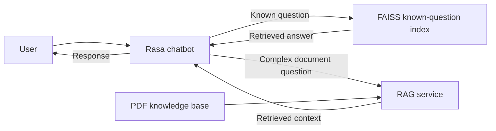

# 🧠 AI Chatbot Platform

A smart, multilingual chatbot developed by **[ESSID Saria]** with **Rasa** and Python, designed for internal use at **[DSI]**.

> ⚠️ **NOTICE**  
> This project is intended **strictly for internal use** within DSI. Unauthorized reproduction, distribution, or reuse—particularly for external, personal, academic, or commercial use—is **prohibited**.

---

## 🛠️ Technologies Used

- **Conversational orchestration:** Rasa
- **Custom actions and routing:** Python
- **Known-question retrieval:** FAISS
- **Complex, document-based questions:** RAG retrieval over PDF documents
- **Deployment:** Docker (where configured)

---

## 🔎 Hybrid Question Answering

The chatbot uses two retrieval paths, selected according to the question:

- **Known questions:** retrieve a matching answer from the FAISS index.
- **Complex questions:** use the RAG service to retrieve relevant context from PDF documents; Rasa then uses that context to prepare the response.

---

## Hybrid Intent Routing

The chatbot routes approximately 83 intents to different response paths:

| Route                   | Intents | Response source                                                                                                 |
|-------------------------|--------:|-----------------------------------------------------------------------------------------------------------------|
| Default                 |       5 | Default conversation handling, including `nlu_fallback`, `affirm_helpful`, `deny_helpful`, `affirm`, and `deny` |
| Easy: candidate results |       6 | Spring Boot services                                                                                            |
| Easy: FAQ               |      22 | Direct semantic search using FAISS                                                                              |
| Exceptions              |      10 | Local PDF or JSON files                                                                                         |
| Hard questions          |      40 | RAG retrieval over Markdown knowledge-base files                                                                |

When a question does not match the FAQ similarity threshold, the conversation is passed to `ActionMaintainConversationFlow` for LLM-based fallback handling.

### Out-of-scope and missing-context behavior

Semantic FAISS threshold is your relevance decision mechanism:
- Similarity score satisfies the threshold → RELATED → continue with the appropriate response route.
- Similarity score does not satisfy the threshold → UNRELATED → invoke solo_feedback().

The fallback prompt includes instructions from `solo_feedback()`.
When a question is unrelated to PGPG, ESPRIT, or DSI—or when the RAG context is empty—the LLM is instructed to explain the chatbot’s scope.
It may provide general information when appropriate, clearly marked as general rather than official PGPG information.
If the user expresses an emotion, the chatbot responds empathetically before explaining its scope.

### Example of simple discussion :
- 👤 donner la mission de ef
- 🤖👍 Trés précieuse comme remarque,
L'Enseignant Formateur (EF) assure des modules d’enseignement en autonomie, encadre des projets étudiants et stages, participe à la conception et à l’évaluation des examens, et contribue à l’amélioration des contenus pédagogiques, sans gérer les sessions.

- 👤 et pour efs
- 🤖🧠 Bonne question !,
La mission de l'Enseignant Formateur Sénior (EFS) comprend : concevoir et actualiser les programmes pédagogiques, encadrer les PFE et activités de recherche, accompagner et encadrer les enseignants, participer à l’innovation pédagogique et contribuer aux orientations académiques. L'EFS participe à une session de passage de grades mais ne la gère pas.

- 👤 vie en rose
- 🤖✍️ C'est noté,
Votre demande concernant "vie en rose" ne semble pas liée au système de passage de grades PGPG, à l'ESPRIT ou au support technique DSI ; il s'agit probablement d'une référence culturelle (chanson, film ou expression) qui dépasse donc le périmètre de mon assistance, mais je reste disponible si vous avez une question officielle sur vos grades.

- 👤 ef vs elcc
- 🤖 🙌 Tout à fait,
La distinction entre ces deux filières repose exclusivement sur la spécialité du candidat : le parcours Enseignant Formateur (EFA à EFM) est réservé aux spécialités techniques telles que les TIC, l'électromécanique, les mathématiques, le génie civil ou le génie énergétique, tandis que le parcours Enseignant de Langue, Communication et Citoyenneté (ELCC à ELCC2) est strictement limité aux candidats dont la spécialité est les langues.

- 👤 Est-ce que EF est un bon modèle d’ordinateur portable ?
- 🤖 🧠 Bonne question !,
Je comprends votre curiosité, mais je ne peux vous aider que sur les parcours EF et ELCC du système PGPG, et non sur le choix d'ordinateurs portables.

---

## 📌 Project Purpose    

This chatbot was developed to:
- Assist employees with real-time, AI-driven support on internal platforms
- Handle multilingual queries (English, Arabic, etc.): To be done in near future
- Automate common FAQ and support tasks
- Serve as an evolving knowledge assistant for the enterprise

---

### Multi-Signal Follow-Up Decision Mechanism

The chatbot uses a **multi-signal decision mechanism** to determine whether a new user question is a contextual follow-up or an independent question.

The decision is not based solely on question length or semantic similarity.

#### 1. Basic Semantic Follow-Up Criterion

The `is_basicfollowup_criteria()` method provides an initial semantic signal:

- Checks whether a previous user question exists.
- Generates embeddings for the current and previous questions.
- Computes their cosine similarity.
- Compares the similarity score against the configured `FOLLOWUP_THRESHOLD`.

This method returns a Boolean indicating whether the questions are sufficiently semantically similar.

**Important:** This is only a basic follow-up criterion. A short question is not automatically considered a follow-up. The previously used short-question heuristic has been deliberately removed to avoid false positives.

#### 2. Multi-Signal Decision Evaluation

The initial semantic result is combined with the broader decision mechanism implemented in `get_decision_infos()`.

The decision process takes into account conversational information, including:

- The current user question.
- The previous user question.
- The current predicted intent.
- The previous intent.
- The decision mode returned by the multi-signal evaluation.

This allows the chatbot to consider the conversational context rather than relying on a single similarity score.

#### 3. Final Follow-Up Action

The `get_forwarded_action()` method combines:

- The basic semantic follow-up criterion.
- The decision mode produced by the multi-signal mechanism.
- The conversation's existing intent and flow information.

Based on this evaluation, the chatbot determines whether to forward the conversation to an appropriate previous action or continue with the normal intent-handling process.

The resulting events are flattened before being returned to Rasa.

#### 4. Expected Behavior

| Scenario                                                          | Expected behavior                                   |
|-------------------------------------------------------------------|-----------------------------------------------------|
| A semantically related question that continues the previous topic | Can be classified as a contextual follow-up         |
| A short question without relevant conversational context          | Must not automatically be classified as a follow-up |
| A question referring to a previous topic using different wording  | Evaluated using the combined decision mechanism     |
| An independent question unrelated to the previous conversation    | Should be handled as a new question                 |

**Design principle:** Semantic similarity provides an initial signal; the final follow-up decision is made through the combined multi-signal mechanism. This separation helps reduce false positives and preserve conversational continuity.

---

## 🔒 Intellectual Property & Usage Policy

This repository is the intellectual property of **[ESSID Saria]**, developed during tenure at **[DSI]**, with clear contributions tracked via Git.

All contributors are allowed to:
- Use this platform for internal purposes only
- Contribute to its improvement under company authorization

You **must not**:
- Reuse the codebase for personal academic projects
- Fork or clone this repository for external use
- Publish this code or its parts on public platforms (e.g., GitHub, GitLab, StackOverflow)
- Share with or sell to third parties

Violations will be reported and may lead to **disciplinary or legal action** depending on the terms of your employment or internship agreement.

---

## 🧾 Author & Ownership

- **Main Developer:** [ESSID Saria] ([saria.essid@esprit.tn])
- **Status:** Sole author and maintainer during initial development (100% commit history)
- **Company:** [ESPRIT-DSI]

---

## 📄 License

This project is licensed under a **Proprietary License**:  
You **cannot** use, copy, modify, merge, publish, distribute, sublicense, or sell copies of this Software or its parts outside the scope of internal enterprise use.

Contact **[ESSID Saria]** or the **IT Department** for special permissions.

---

## 🤝 Contributions

To contribute:
1. Make a new branch from `main`
2. Submit a pull request with a clear explanation
3. Ensure no hardcoded or private data is leaked

> Every contribution is logged and monitored.

---

## 🚀 Future Features

- Full analytics dashboard (employee usage stats)
- GPT-based fallback mode
- French & Arabic deep NLP models
- Customizable component support

---

## 👨‍💻 Author & 🙏 Acknowledgments
- Built with ❤️ by [ESSID Saria] 💻
- Thanks to DevOps Responsible [Seddik Bouzayeni] for the commitment
