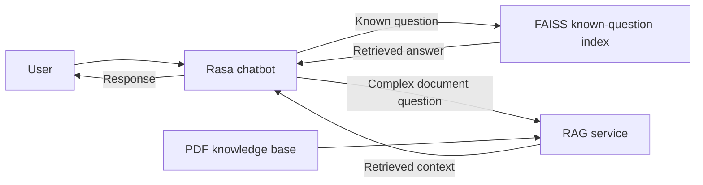

# 🧠 AI Chatbot Platform

A smart, multilingual chatbot developed by **[ESSID Saria]** with **Rasa** and Python, designed for internal use at **[DSI]**.

> ⚠️ **NOTICE**  
> This project is intended **strictly for internal use** within DSI. Unauthorized reproduction, distribution, or reuse—particularly for external, personal, academic, or commercial use—is **prohibited**.

---

## 🛠️ Technologies Used

- **Conversational orchestration:** Rasa
- **Custom actions and routing:** Python
- **Known-question retrieval:** FAISS
- **Complex, document-based questions:** RAG retrieval over PDF documents
- **Deployment:** Docker (where configured)

---

## 🔎 Hybrid Question Answering

The chatbot uses two retrieval paths, selected according to the question:

- **Known questions:** retrieve a matching answer from the FAISS index.
- **Complex questions:** use the RAG service to retrieve relevant context from PDF documents; Rasa then uses that context to prepare the response.

---

## 📌 Project Purpose

This chatbot was developed to:
- Assist employees with real-time, AI-driven support on internal platforms
- Handle multilingual queries (English, French, Arabic, etc.): To be done
- Automate common FAQ and support tasks
- Serve as an evolving knowledge assistant for the enterprise

---

## 🔒 Intellectual Property & Usage Policy

This repository is the intellectual property of **[ESSID Saria]**, developed during tenure at **[DSI]**, with clear contributions tracked via Git.

All contributors are allowed to:
- Use this platform for internal purposes only
- Contribute to its improvement under company authorization

You **must not**:
- Reuse the codebase for personal academic projects
- Fork or clone this repository for external use
- Publish this code or its parts on public platforms (e.g., GitHub, GitLab, StackOverflow)
- Share with or sell to third parties

Violations will be reported and may lead to **disciplinary or legal action** depending on the terms of your employment or internship agreement.

---

## 🧾 Author & Ownership

- **Main Developer:** [ESSID Saria] ([saria.essid@esprit.tn])
- **Status:** Sole author and maintainer during initial development (100% commit history)
- **Company:** [ESPRIT-DSI]

---

## 📄 License

This project is licensed under a **Proprietary License**:  
You **cannot** use, copy, modify, merge, publish, distribute, sublicense, or sell copies of this Software or its parts outside the scope of internal enterprise use.

Contact **[ESSID Saria]** or the **IT Department** for special permissions.

---

## 🤝 Contributions

To contribute:
1. Make a new branch from `main`
2. Submit a pull request with a clear explanation
3. Ensure no hardcoded or private data is leaked

> Every contribution is logged and monitored.

---

## 🚀 Future Features

- Full analytics dashboard (employee usage stats)
- GPT-based fallback mode
- French & Arabic deep NLP models
- Customizable component support

---

## 👨‍💻 Author & 🙏 Acknowledgments
- Built with ❤️ by [ESSID Saria] 💻
- Thanks to DevOps Responsible [Seddik Bouzayeni] for the commitment
